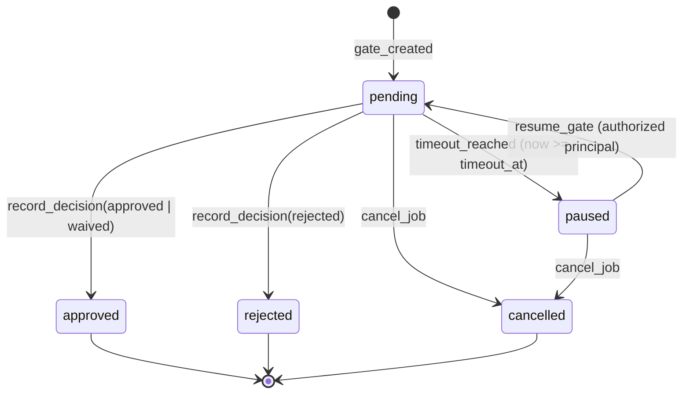
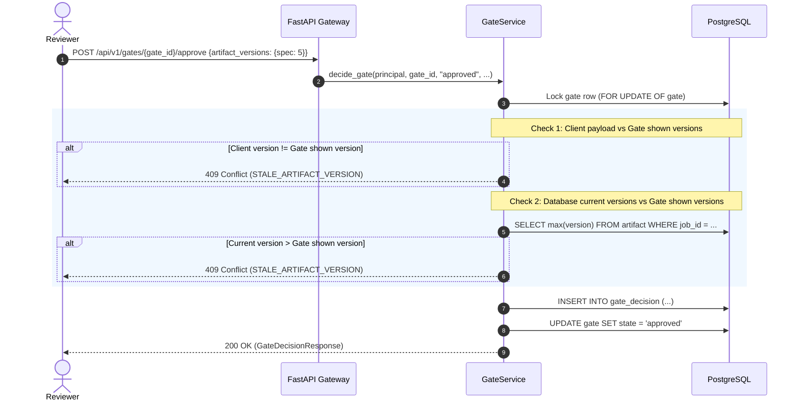
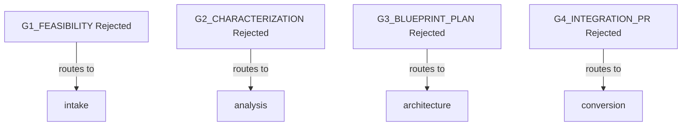

# Sub-Phase 01.10: Human Gates and Append-Only Audit Decisions

## 1. Overview and Core Philosophy

Sub-Phase 01.10 establishes durable, immutable human-in-the-loop approval gate infrastructure across the four TDD workflow gates (`G1_FEASIBILITY`, `G2_CHARACTERIZATION`, `G3_BLUEPRINT_PLAN`, `G4_INTEGRATION_PR`, plus `ESCALATION`).

**Core Architectural Rule:** Human approval is a durable, transactional workflow decision—never an ephemeral in-memory flag or `asyncio.Event`. Every approval, rejection, or waiver is captured as an immutable, append-only record in PostgreSQL that survives process crashes, worker reclaims, API restarts, and LangGraph checkpoint restorations.

---

## 2. Gate State Machine

Gates progress through strict, validated lifecycle transitions governed by `LEGAL_GATE_TRANSITIONS`:



### State Definitions

| State | Mutability | Workflow Action | Description |
| :--- | :--- | :--- | :--- |
| `pending` | Active | Halts at LangGraph `interrupt()` | Human review is actively awaited. |
| `approved` | Terminal | Resumes forward to next stage | Reviewer accepted the artifact versions. |
| `rejected` | Terminal | Routes back to predecessor stage | Reviewer rejected with mandatory rationale. |
| `paused` | Inactive | Halts, awaiting explicit resume | Timeout expired (`now >= timeout_at`); never auto-approved. |
| `cancelled` | Terminal | Aborts | Job or gate cancelled by user/admin. |

### Allowed State Transitions

| From State | Allowed Target States | Enforcing Function |
| :--- | :--- | :--- |
| `pending` | `approved`, `rejected`, `paused`, `cancelled` | `validate_gate_transition` |
| `paused` | `pending`, `cancelled` | `validate_gate_transition` |
| `approved` | *(none - terminal)* | Raises `GateClosedError` / `DuplicateDecisionError` |
| `rejected` | *(none - terminal)* | Raises `GateClosedError` / `DuplicateDecisionError` |
| `cancelled`| *(none - terminal)* | Raises `GateClosedError` / `DuplicateDecisionError` |

---

## 3. Append-Only Immutable Decision History

Every human decision writes an immutable entry into `gate_decision`. Decision records are never mutated or deleted.

```sql
CREATE TABLE gate_decision (
    id UUID PRIMARY KEY,
    gate_id UUID NOT NULL REFERENCES gate(id) ON DELETE CASCADE,
    job_id UUID REFERENCES job(id) ON DELETE CASCADE,
    gate_type VARCHAR(50),
    actor VARCHAR(255) NOT NULL,
    actor_user_id UUID REFERENCES user_account(id) ON DELETE SET NULL,
    approver_role VARCHAR(50),
    decision VARCHAR(50) NOT NULL,
    feedback TEXT,
    waivers JSONB,
    artifact_version_refs JSONB,
    artifact_diff_ref VARCHAR(512),
    decided_at TIMESTAMPTZ NOT NULL DEFAULT NOW()
);
```

### Immutability Invariants
1. **No UPDATE or DELETE**: No API or service method updates or deletes a `GateDecision`.
2. **Audit Attribution**: The decision explicitly stores the authenticated principal's `user_id`, `actor` (subject identifier), and active `approver_role`.
3. **Artifact Snapshot**: Exact artifact versions shown and reviewed are bound into `artifact_version_refs` alongside the decision.

---

## 4. Artifact Version Binding & Anti-Stale Approval Protection

To prevent approving stale or drifted code:



If any reviewed artifact version has incremented in the database since the gate was opened:
- The approval is rejected with `StaleArtifactVersionError` (`409 Conflict`).
- The gate remains in its current state.
- No silent retargeting of approvals is permitted.

---

## 5. Authorization Model

Authorization integrates directly with the platform's RBAC matrix:

```text
Principal Authenticated
         +
Role IN (APPROVER, ADMIN, OWNER)
         +
Permission.GATE_DECIDE
         +
Job Tenant Match & Membership Access
         +
Gate in PENDING State
```

- Reviewer identity is derived exclusively from the authoritative `AuthenticatedPrincipal`.
- Client-supplied `actor_id` or `approver_role` fields in request bodies are ignored and forbidden.
- Unauthorized users or reviewers without `GATE_DECIDE` receive `403 Forbidden`.

---

## 6. Rejection Routing Semantics

When a gate is rejected, execution does not fail destructively. Instead, the workflow returns to the appropriate predecessor stage to address the feedback:



### Rejection Requirements
1. **Mandatory Written Rationale**: `reason` must be provided, non-empty, and non-whitespace. Blank rationale is rejected with `422 Unprocessable Entity` / `400 Bad Request`.
2. **History Accumulation**: Rejection details (`gate_type`, `actor`, `feedback`, `timestamp`) append to `rejection_history` in workflow state.
3. **Stage Rollback**: Intermediate completion flags downstream of the target stage are reset, allowing clean re-execution.

---

## 7. Timeout Behavior: Timeout-to-Paused

Timeout is a defensive boundary—it halts workflow execution without destroying state:

```text
now >= gate.timeout_at
          ↓
gate.state transitions to PAUSED
job.status transitions to PAUSED
audit event GATE_PAUSED recorded
notification GATE_PAUSED dispatched
```

### Critical Invariants
- **Timeout Never Produces Approval**: Automatic timeout-based advancement is strictly forbidden.
- **Recovery via Explicit Resume**: An authorized approver must call `POST /api/v1/gates/{gate_id}/resume` to reset `state = pending` and restore execution.
- **Durable Scanner**: `GateService.check_and_handle_timeouts()` queries PostgreSQL for `state = 'pending' AND timeout_at <= now()`, surviving worker restarts and node crashes.

---

## 8. Concurrency Protection & Transactional Row Locking

To prevent race conditions where two concurrent requests both attempt to decide or modify the same gate:

```sql
SELECT gate.*
FROM gate
JOIN job ON job.id = gate.job_id
WHERE gate.id = :gate_id AND job.tenant_id = :tenant_id
FOR UPDATE OF gate;
```

1. The first transaction locks the gate row and evaluates the current state.
2. The second transaction blocks until the first commits.
3. Upon acquiring the lock, the second transaction observes `state = 'approved'` (or `'rejected'`), immediately failing with `DuplicateDecisionError` (`409 Conflict`).

---

## 9. LangGraph Interrupt and Resume Integration

When execution reaches a gate node:
1. `make_gate_node` queries if an approved decision exists for `gate_type` in `state["gate_approvals"]`.
2. If absent:
   - Emits `interrupt({"gate_type": gate_type, "status": "pending_human_review", "job_id": job_id})`.
   - Workflow state is checkpointed in PostgreSQL (`AsyncPostgresSaver`).
   - Task worker finishes gracefully without error.
3. Upon approval:
   - `GateService.resume_workflow_after_gate` calls `WorkflowEngine.resume_workflow(job_id, {"decision": "approved", ...})`.
   - Checkpointer restores state using stable `job_id == thread_id`.
   - Gate node records approval in `gate_approvals` and transitions graph to `next_phase`.

---

## 10. Notification Hooks

An decoupled internal event dispatcher (`GateNotificationDispatcher`) emits structured events without hardcoding third-party transport dependencies:

- `gate_created`: Gate opened, reviewer review needed.
- `gate_approved`: Gate approved, workflow proceeding.
- `gate_rejected`: Gate rejected with rationale, workflow rerouted.
- `gate_paused`: Gate timed out, manual attention required.
- `gate_resumed`: Gate resumed by approver, review active again.

---

## 11. REST API Contract Reference

| Method | Endpoint | Description | Auth Required |
| :--- | :--- | :--- | :--- |
| `POST` | `/api/v1/jobs/{job_id}/gates` | Create/register human approval gate | `GATE_CREATE` |
| `GET` | `/api/v1/gates/{gate_id}` | Retrieve gate details and decision history | `GATE_VIEW` |
| `GET` | `/api/v1/jobs/{job_id}/gates` | List all gates for a job | `GATE_VIEW` |
| `POST` | `/api/v1/gates/{gate_id}/decide` | Submit general decision (approve/reject/waive) | `GATE_DECIDE` |
| `POST` | `/api/v1/gates/{gate_id}/approve` | Dedicated approval endpoint | `GATE_DECIDE` |
| `POST` | `/api/v1/gates/{gate_id}/reject` | Dedicated rejection endpoint (requires reason) | `GATE_DECIDE` |
| `POST` | `/api/v1/gates/{gate_id}/resume` | Resume paused gate after timeout | `GATE_DECIDE` |
| `GET` | `/api/v1/gates/{gate_id}/decisions` | Retrieve immutable decision audit trail | `GATE_VIEW` |
