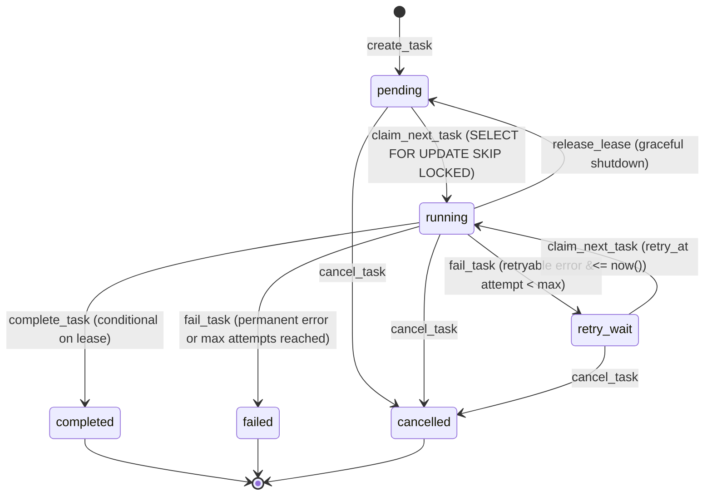
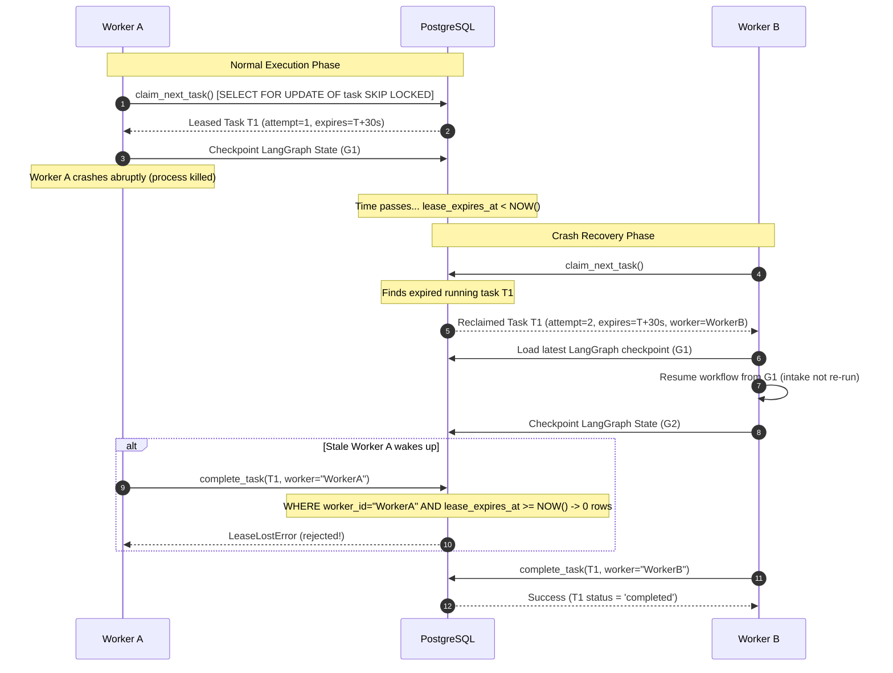

# Sub-Phase 01.9: Worker Leases and Durable Task Execution

## 1. Overview and Core Philosophy

Sub-Phase 01.9 establishes a resilient, database-backed background task execution system using PostgreSQL as the durable task coordination mechanism.

**Core Architectural Rule:** No external queue service (Redis, Celery, RabbitMQ, Kafka, SQS) is introduced. PostgreSQL transactions and `SELECT ... FOR UPDATE SKIP LOCKED` provide atomic claiming, lease ownership, and crash recovery.

### Conceptual Hierarchy

| Abstraction | Scope & Responsibility | Authority |
| :--- | :--- | :--- |
| **Job** | Overall modernization lifecycle across all phases and gates. | PostgreSQL `job` table |
| **Workflow** | Resumable multi-phase graph execution state for a job. | LangGraph checkpoints (`AsyncPostgresSaver`) |
| **Task** | Discrete durable unit of background execution claimed by a worker. | PostgreSQL `task` table |
| **Worker Lease** | Temporary, ownership-protected execution right over a task. | `worker_id` + `lease_expires_at` in `task` |

---

## 2. Task Lifecycle State Machine

Tasks progress through strict, validated state transitions:



### State Definitions

- **`pending`**: Task is persisted and eligible for atomic claiming by any active worker.
- **`running`**: Task is actively leased to a specific `worker_id` with `lease_expires_at > now()`.
- **`retry_wait`**: Task encountered a transient error (`RETRYABLE_INFRASTRUCTURE_ERROR`) and is waiting for exponential backoff delay (`retry_at <= now()`).
- **`completed`**: Terminal success. Result payload persisted in PostgreSQL.
- **`failed`**: Terminal failure. Either deterministic (`PERMANENT_FAILURE`) or maximum attempts exhausted.
- **`cancelled`**: Task was explicitly aborted (e.g. parent job was cancelled).

---

## 3. Atomic Claiming Algorithm (`FOR UPDATE OF task SKIP LOCKED`)

Workers scan for tasks without blocking peer workers or locking the parent `job` record:

```sql
SELECT task.*
FROM task
JOIN job ON task.job_id = job.id
WHERE (
    task.status = 'pending'
    OR (task.status = 'retry_wait' AND (task.retry_at IS NULL OR task.retry_at <= NOW()))
    OR (task.status = 'running' AND task.lease_expires_at < NOW())
)
AND job.status != 'cancelled'
ORDER BY
    task.status DESC,       -- Recover expired running tasks first
    task.created_at ASC,    -- FIFO order
    task.id ASC             -- Deterministic tiebreaker
LIMIT 1
FOR UPDATE OF task SKIP LOCKED;
```

Upon claiming:
1. `worker_id` is assigned to claiming worker.
2. `status` transitions to `'running'`.
3. `attempt_count` is incremented.
4. `lease_expires_at` is set to `NOW() + INTERVAL '30 seconds'`.
5. Immutable audit event `TASK_CLAIMED` (or `TASK_RECLAIMED`) is emitted.

---

## 4. Lease Ownership, Automated Renewal, and Stale-Worker Protection

### Lease Renewal
- Each worker runs a `LeaseManager` background renewal supervisor.
- Tasks actively being processed are renewed periodically (`task_lease_renewal_seconds = 10.0s`).
- Renewal query validates current ownership:
  ```sql
  UPDATE task
  SET lease_expires_at = NOW() + INTERVAL '30 seconds', updated_at = NOW()
  WHERE id = :task_id
    AND worker_id = :worker_id
    AND status = 'running'
    AND lease_expires_at >= NOW();
  ```
- If 0 rows are updated, the worker has lost ownership (expired or reclaimed by a peer) and halts processing.

### Stale-Worker and Duplicate Finalization Protection
When a worker completes a task:
```sql
UPDATE task
SET status = 'completed', result = :result_payload, completed_at = NOW(), lease_expires_at = NULL, updated_at = NOW()
WHERE id = :task_id
  AND worker_id = :worker_id
  AND status = 'running'
  AND lease_expires_at >= NOW();
```
If a stale worker attempts to complete a task after its lease expired and was reclaimed by Worker B:
- The update affects 0 rows.
- `TaskRepository` raises `LeaseLostError`.
- Duplicate finalization or clobbering of legitimate work is physically prevented by PostgreSQL.

---

## 5. Crash Recovery Sequence



---

## 6. Failure Classification and Retry Policy

Failure handling is governed by explicit classification rather than arbitrary retry:

| Classification | Examples | Behavior |
| :--- | :--- | :--- |
| **`RETRYABLE_INFRASTRUCTURE_ERROR`** | `TimeoutError`, `OperationalError`, `ConnectionResetError`, `PersistenceError`, `CheckpointError` | If `attempt_count < max_attempts`, schedules retry with exponential backoff: `base * 2^(attempt - 1)`. Status becomes `retry_wait`. |
| **`PERMANENT_FAILURE`** | `ValueError`, `KeyError`, `ValidationFailure`, `ConfigError`, `PolicyViolation` | Immediate terminal failure. Status becomes `failed`. No retries attempted. |
| **`CANCELLATION`** | `asyncio.CancelledError`, parent job cancellation | Task marked `cancelled`. Clean lease release. |

---

## 7. Graceful Worker Shutdown

On graceful termination (e.g. `SIGTERM`, `SIGINT`, or worker stop):
1. Worker stops accepting new tasks (`should_stop = True`).
2. In-flight tasks are afforded a bounded grace window (`task_shutdown_grace_seconds = 15.0s`).
3. Lease renewal supervisor is stopped to prevent extending abandoned leases.
4. Active, uncompleted tasks are explicitly released back to `'pending'` in PostgreSQL (`status='pending', worker_id=None, lease_expires_at=None`).
5. Peer workers can immediately claim and execute the abandoned tasks without waiting for lease timeout.
6. If the process is killed abruptly (`kill -9` or node failure), lease expiry (`lease_expires_at < now()`) safely guarantees recovery.
