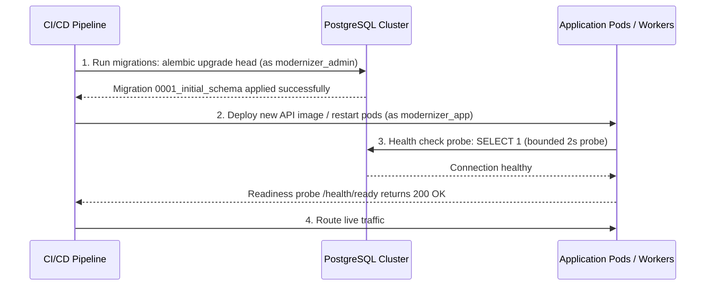

# Production Database Deployment & Operations Runbook
## Multi-Agent Legacy Code Modernization Platform — Sub-Phase 01.2

This runbook guides DevOps, Platform Engineers, and Database Administrators through deploying, configuring, and maintaining the PostgreSQL persistence layer in production.

---

## 1. Pre-Deployment Checklist

Before deploying a new version to production, verify:

- [ ] PostgreSQL version is 16 or newer.
- [ ] Database storage uses fast SSDs with automatic volume expansion enabled.
- [ ] TLS is enabled on PostgreSQL (`ssl = on`) with valid certificates.
- [ ] The three operational roles (`modernizer_admin`, `modernizer_app`, `modernizer_readonly`) have been provisioned using `01_provision_roles.sql`.
- [ ] Database passwords meet corporate complexity requirements and are injected via HashiCorp Vault, AWS Secrets Manager, or Kubernetes Secrets (not committed in Git or plain files).
- [ ] Pre-deployment database backup snapshot is created and verified.

---

## 2. Deployment Sequence

Follow this strict ordering for application deployments:

---

## 3. Connection Pool Sizing & Tuning

In production, connection pooling is managed at two layers:
1. **Application Process Pool** (`SQLAlchemy AsyncEngine`):
   - `DB_POOL_SIZE`: Default `10` connections per worker process.
   - `DB_MAX_OVERFLOW`: Default `20` burst connections.
   - `DB_POOL_RECYCLE_SECONDS`: Default `1800` (30 minutes) to prevent stale socket dropouts.
   - `DB_POOL_TIMEOUT_SECONDS`: Default `30.0` seconds before rejecting client requests.
2. **PostgreSQL Server Capacity Calculation**:
   $$ \text{Total Max Connections} = (\text{API Pods} \times \text{Uvicorn Workers} \times (\text{POOL\_SIZE} + \text{MAX\_OVERFLOW})) + \text{Reserved (Admin/Monitoring)} $$
   *Example*: 4 pods $\times$ 2 workers $\times$ 30 connections = 240 active connections. Set PostgreSQL `max_connections = 300`.
   For larger replica counts, place **PgBouncer** in transaction pooling mode between the API and PostgreSQL.

---

## 4. Health Checks & Observability

- **Liveness (`GET /health/live`)**:
  - Independent of database state. Evaluates purely whether the Python process is responsive.
- **Readiness (`GET /health/ready`)**:
  - Executes a bounded connectivity probe (`SELECT 1`) with a 2-second timeout.
  - If the database is unreachable, returns `HTTP 503 Service Unavailable` with `{"status": "not_ready", "probes": {"database": {"ready": false, "message": "..."}}}`.
  - Kubernetes / cloud load balancers automatically stop routing traffic to unhealthy pods without terminating them prematurely.
