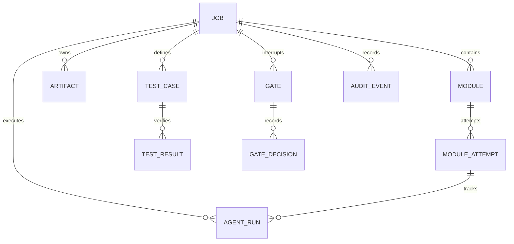

# PostgreSQL Relational Schema Architecture
## Multi-Agent Legacy Code Modernization Platform — Sub-Phase 01.2

This document specifies the authoritative relational schema, table structures, foreign keys, indexes, check constraints, and referential deletion policies implemented in Sub-Phase 01.2.

---

## 1. Schema Overview

The relational schema is implemented in PostgreSQL 16+ using **SQLAlchemy 2.0 Typed Mappings** and governed by **Alembic**.

All tables reside in the `public` schema. Identifiers use native UUIDv4 (`GUID` type decorator), timestamps are stored with explicit timezone normalization (`UTCDateTime`), and structured configurations utilize native PostgreSQL `JSONB`.

---

## 2. Entity Specifications

### 2.1. `job`
Top-level orchestration job managing legacy codebase modernization.

| Column | Type | Nullable | Default | Description |
|---|---|---|---|---|
| `id` | `UUID` | No | `uuid4()` | Primary key |
| `owner` | `VARCHAR(128)` | No | - | Tenant or operator identity |
| `source_ref` | `VARCHAR(512)` | No | - | Git URL or source bundle reference |
| `target_stack_spec` | `JSONB` | No | `{}` | Target languages, frameworks, and architecture |
| `budget` | `JSONB` | No | `{}` | Cost and token allocations |
| `status` | `VARCHAR(32)` | No | `'pending'` | Current lifecycle status |
| `created_at` | `TIMESTAMPTZ` | No | `now()` | Job creation timestamp |
| `updated_at` | `TIMESTAMPTZ` | No | `now()` | Last modification timestamp |

- **Indexes**:
  - `ix_job_status` ON (`status`)
  - `ix_job_created_at` ON (`created_at` DESC)
- **Check Constraints**:
  - `ck_job_status`: `status IN ('pending', 'running', 'paused', 'completed', 'failed', 'cancelled')`
- **Deletion Policy**:
  - Root entity. Deleting a job cascades to working modules and artifacts, but is restricted if historical audit records exist.

---

### 2.2. `artifact`
Immutable versioned intermediate representations, specifications, and converted code.

| Column | Type | Nullable | Default | Description |
|---|---|---|---|---|
| `id` | `UUID` | No | `uuid4()` | Primary key |
| `job_id` | `UUID` | No | - | FK to `job.id` (`ON DELETE CASCADE`) |
| `type` | `VARCHAR(64)` | No | - | Artifact classification (e.g. `IR_AST`, `CODE`) |
| `version` | `INTEGER` | No | `1` | Monotonically increasing version per (job, type) |
| `content_hash` | `VARCHAR(128)` | No | - | SHA-256 hash of artifact content |
| `storage_ref` | `VARCHAR(512)` | No | - | S3/MinIO URI reference (no raw blobs in DB) |
| `derived_from` | `JSONB` | No | `[]` | Parent artifact references for lineage |
| `artifact_metadata` | `JSONB` | No | `{}` | Structured parsing metadata |
| `produced_by_run_id` | `UUID` | Yes | `NULL` | FK to `agent_run.id` (`ON DELETE SET NULL`) |
| `created_at` | `TIMESTAMPTZ` | No | `now()` | Immutability timestamp |

- **Unique Constraints**:
  - `uq_artifact_job_type_version`: UNIQUE (`job_id`, `type`, `version`)
- **Indexes**:
  - `ix_artifact_job_id` ON (`job_id`)
  - `ix_artifact_content_hash` ON (`content_hash`)
- **Check Constraints**:
  - `ck_artifact_version_positive`: `version > 0`

---

### 2.3. `module`
Decomposed conversion unit within the codebase dependency DAG.

| Column | Type | Nullable | Default | Description |
|---|---|---|---|---|
| `id` | `UUID` | No | `uuid4()` | Primary key |
| `job_id` | `UUID` | No | - | FK to `job.id` (`ON DELETE CASCADE`) |
| `name` | `VARCHAR(128)` | No | - | Module logical name |
| `legacy_paths` | `JSONB` | No | - | List of source file paths |
| `depends_on` | `JSONB` | No | `[]` | List of upstream module names |
| `risk_score` | `FLOAT` | No | `0.0` | Algorithmic migration risk score |
| `status` | `VARCHAR(32)` | No | `'pending'` | Conversion status |
| `created_at` | `TIMESTAMPTZ` | No | `now()` | Timestamp |
| `updated_at` | `TIMESTAMPTZ` | No | `now()` | Timestamp |

- **Unique Constraints**:
  - `uq_module_job_name`: UNIQUE (`job_id`, `name`)
- **Indexes**:
  - `ix_module_job_id` ON (`job_id`)
  - `ix_module_status` ON (`status`)
- **Check Constraints**:
  - `ck_module_status`: `status IN ('pending', 'in_progress', 'converted', 'verified', 'failed')`

---

### 2.4. `module_attempt`
Individual iterative conversion attempt for a module.

| Column | Type | Nullable | Default | Description |
|---|---|---|---|---|
| `id` | `UUID` | No | `uuid4()` | Primary key |
| `module_id` | `UUID` | No | - | FK to `module.id` (`ON DELETE CASCADE`) |
| `attempt_number` | `INTEGER` | No | - | 1-indexed attempt number |
| `branch` | `VARCHAR(256)` | No | - | Ephemeral Git branch name |
| `commit_hash` | `VARCHAR(64)` | Yes | `NULL` | Git commit SHA |
| `outcome` | `VARCHAR(32)` | No | `'in_progress'` | Attempt outcome |
| `failure_summary` | `TEXT` | Yes | `NULL` | Verification failure summary |
| `tactic` | `VARCHAR(64)` | Yes | `NULL` | Conversion tactic used |
| `created_at` | `TIMESTAMPTZ` | No | `now()` | Timestamp |
| `updated_at` | `TIMESTAMPTZ` | No | `now()` | Timestamp |

- **Unique Constraints**:
  - `uq_module_attempt_number`: UNIQUE (`module_id`, `attempt_number`)
- **Indexes**:
  - `ix_module_attempt_module_id` ON (`module_id`)
- **Check Constraints**:
  - `ck_module_attempt_number_positive`: `attempt_number > 0`
  - `ck_module_attempt_outcome`: `outcome IN ('in_progress', 'success', 'failed', 'abandoned')`

---

### 2.5. `agent_run`
Telemetry and step provenance for individual agent executions.

| Column | Type | Nullable | Default | Description |
|---|---|---|---|---|
| `id` | `UUID` | No | `uuid4()` | Primary key |
| `job_id` | `UUID` | No | - | FK to `job.id` (`ON DELETE CASCADE`) |
| `module_attempt_id` | `UUID` | Yes | `NULL` | FK to `module_attempt.id` (`ON DELETE SET NULL`) |
| `step_key` | `VARCHAR(64)` | Yes | `NULL` | LangGraph workflow step key |
| `agent` | `VARCHAR(64)` | No | - | Agent identity (e.g. `DISCOVERY_AGENT`) |
| `model` | `VARCHAR(64)` | No | - | Model identifier (e.g. `deepseek-r1`) |
| `prompt_version` | `VARCHAR(32)` | No | - | Git commit or semver of prompt template |
| `input_artifact_ids` | `JSONB` | No | `[]` | List of input artifact IDs |
| `output_artifact_ids` | `JSONB` | No | `[]` | List of output artifact IDs |
| `tokens_input` | `INTEGER` | No | `0` | Input token count |
| `tokens_output` | `INTEGER` | No | `0` | Output token count |
| `cost_cents` | `FLOAT` | No | `0.0` | Cost in USD cents |
| `duration_ms` | `INTEGER` | No | `0` | Wall-clock execution time |
| `tool_calls` | `JSONB` | No | `[]` | Structured record of tool invocations |
| `created_at` | `TIMESTAMPTZ` | No | `now()` | Execution timestamp |

- **Indexes**:
  - `ix_agent_run_job_id` ON (`job_id`)
  - `ix_agent_run_attempt_id` ON (`module_attempt_id`)

---

### 2.6. `test_case`
Characterization test cases frozen at Gate G2.

| Column | Type | Nullable | Default | Description |
|---|---|---|---|---|
| `id` | `UUID` | No | `uuid4()` | Primary key |
| `job_id` | `UUID` | No | - | FK to `job.id` (`ON DELETE CASCADE`) |
| `suite_version` | `INTEGER` | No | `1` | Test suite iteration |
| `module_name` | `VARCHAR(128)` | Yes | `NULL` | Target module name |
| `layer` | `VARCHAR(32)` | No | - | Test layer (`UNIT`, `INTEGRATION`, `EQUIVALENCE`) |
| `legacy_capture_ref` | `VARCHAR(512)` | No | - | MinIO/S3 reference to legacy I/O capture |
| `normalization_rule_ids` | `JSONB` | No | `[]` | Applied output normalization rules |
| `captured_from` | `VARCHAR(64)` | No | `'legacy_run'` | Provenance source |
| `created_at` | `TIMESTAMPTZ` | No | `now()` | Creation timestamp |

- **Indexes**:
  - `ix_test_case_job_id` ON (`job_id`)
  - `ix_test_case_suite_version` ON (`job_id`, `suite_version`)

---

### 2.7. `test_result`
Deterministic test execution outcome produced by the Verifier.

| Column | Type | Nullable | Default | Description |
|---|---|---|---|---|
| `id` | `UUID` | No | `uuid4()` | Primary key |
| `test_case_id` | `UUID` | No | - | FK to `test_case.id` (`ON DELETE CASCADE`) |
| `run_id` | `UUID` | Yes | `NULL` | FK to `agent_run.id` (`ON DELETE SET NULL`) |
| `system` | `VARCHAR(32)` | No | - | Tested system (`LEGACY` or `MODERNIZED`) |
| `outcome` | `VARCHAR(16)` | No | - | `'passed'`, `'failed'`, `'error'` |
| `diff_summary` | `TEXT` | Yes | `NULL` | Semantic difference summary |
| `raw_output_ref` | `VARCHAR(512)` | Yes | `NULL` | Storage URI to raw execution trace |
| `executed_at` | `TIMESTAMPTZ` | No | `now()` | Execution timestamp |

- **Indexes**:
  - `ix_test_result_test_case_id` ON (`test_case_id`)
  - `ix_test_result_outcome` ON (`outcome`)

---

### 2.8. `gate`
Human-in-the-loop approval gate interrupt nodes (G1-G4 + Escalation).

| Column | Type | Nullable | Default | Description |
|---|---|---|---|---|
| `id` | `UUID` | No | `uuid4()` | Primary key |
| `job_id` | `UUID` | No | - | FK to `job.id` (`ON DELETE CASCADE`) |
| `gate_type` | `VARCHAR(32)` | No | - | `G1_DISCOVERY`, `G2_EQUIVALENCE`, `G3_CODE_REVIEW`, `G4_CUTOVER`, `ESCALATION` |
| `state` | `VARCHAR(32)` | No | `'pending'` | Current gate state |
| `artifact_versions_shown` | `JSONB` | No | `{}` | Artifact versions presented for review |
| `needs_human_flags` | `JSONB` | No | `[]` | Specific items requiring attention |
| `budget_used_cents` | `FLOAT` | No | `0.0` | Accumulated cost up to interrupt |
| `requested_at` | `TIMESTAMPTZ` | No | `now()` | Gate trigger timestamp |
| `resolved_at` | `TIMESTAMPTZ` | Yes | `NULL` | Decision resolution timestamp |

- **Indexes**:
  - `ix_gate_job_id` ON (`job_id`)
  - `ix_gate_state` ON (`state`)
- **Check Constraints**:
  - `ck_gate_state`: `state IN ('pending', 'approved', 'rejected', 'expired')`

---

### 2.9. `gate_decision`
Human decisions, rationale, feedback, and waivers recorded on gates.

| Column | Type | Nullable | Default | Description |
|---|---|---|---|---|
| `id` | `UUID` | No | `uuid4()` | Primary key |
| `gate_id` | `UUID` | No | - | FK to `gate.id` (`ON DELETE RESTRICT`) |
| `actor` | `VARCHAR(128)` | No | - | Identity of approver/reviewer |
| `decision` | `VARCHAR(32)` | No | - | `'approved'`, `'rejected'`, `'request_changes'` |
| `feedback` | `TEXT` | Yes | `NULL` | Written review rationale |
| `waivers` | `JSONB` | No | `{}` | Approved waivers for failed invariants |
| `created_at` | `TIMESTAMPTZ` | No | `now()` | Decision timestamp |

- **Deletion Policy**:
  - `ON DELETE RESTRICT`: Gates with human approval decisions cannot be deleted while decisions exist, protecting regulatory audit trails.
- **Indexes**:
  - `ix_gate_decision_gate_id` ON (`gate_id`)

---

### 2.10. `audit_event`
Append-only platform audit ledger recording all significant user, agent, and system actions.

| Column | Type | Nullable | Default | Description |
|---|---|---|---|---|
| `id` | `UUID` | No | `uuid4()` | Primary key |
| `job_id` | `UUID` | Yes | `NULL` | FK to `job.id` (`ON DELETE SET NULL`) |
| `actor` | `VARCHAR(128)` | No | - | Actor identity (`user:<id>`, `agent:<name>`, `system`) |
| `action` | `VARCHAR(64)` | No | - | Action name (e.g. `JOB_STARTED`, `GATE_APPROVED`) |
| `correlation_id` | `VARCHAR(128)` | Yes | `NULL` | Request correlation ID |
| `payload` | `JSONB` | No | `{}` | Sanitized event context payload |
| `event_version` | `INTEGER` | No | `1` | Schema version of the event structure |
| `event_time` | `TIMESTAMPTZ` | No | `now()` | Monotonic audit timestamp |

- **Indexes**:
  - `ix_audit_event_job_id` ON (`job_id`)
  - `ix_audit_event_correlation_id` ON (`correlation_id`)
  - `ix_audit_event_time` ON (`event_time` DESC)
- **Application-Layer Immutability**:
  - `AuditEventRepository` exposes only `append_event`, `get_by_id`, and `list_events`. No update or delete operations exist.
- **Database-Layer Protection**:
  - The runtime application role (`modernizer_app`) has only `SELECT` and `INSERT` privileges. `UPDATE` and `DELETE` are revoked.
